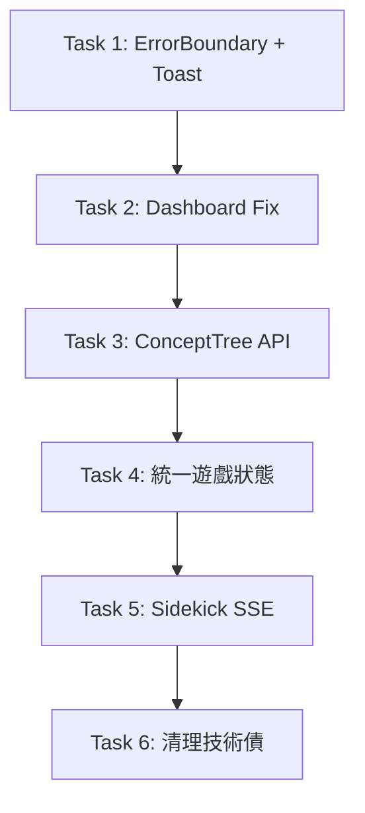

# PLKS 前端關鍵修復實作計畫

> **For agentic workers:** REQUIRED SUB-SKILL: Use superpowers:subagent-driven-development (recommended) or superpowers:executing-plans to implement this plan task-by-task. Steps use checkbox (`- [ ]`) syntax for tracking.

**Goal:** 修復前端 5 個 P0 級別關鍵問題：Dashboard 重複 fetch、ConceptTree API 缺失、SidekickChat 模擬串流、遊戲狀態雙套制、ErrorBoundary 未啟用

**Architecture:** 採用漸進式修復，優先解決阻塞功能的 API 缺失與狀態管理衝突，再統一錯誤處理與載入體驗。每個任務獨立可測試，不破壞現有功能。

**Tech Stack:** React 18, TypeScript, TanStack Query v5, Zustand, React Router v6, Vite

## Global Constraints

- 所有 API 呼叫需攜帶 Bearer Token (從 AuthContext 取得)
- TypeScript strict mode, noUncheckedIndexedAccess, exactOptionalPropertyTypes
- 嚴禁硬編碼 Prompt、Secret、Magic String
- 使用 zod 進行 Runtime 驗證，失敗觸發重試
- 狀態管理：Server State 用 TanStack Query，Client/UI State 用 Zustand
- URL 為單一真相來源 (CoursePage)，所有 UI 狀態同步至 searchParams
- Conventional Commits: `feat`/`fix`/`refactor`/`test`/`chore`

---

### Task 1: 啟用 ErrorBoundary 並新增全域 Toast 系統

**Files:**
- Modify: `apps/web/src/main.tsx:1-30`
- Create: `apps/web/src/components/common/ErrorBoundary.tsx` (已存在，驗證並啟用)
- Create: `apps/web/src/components/common/ToastProvider.tsx`
- Modify: `apps/web/src/App.tsx:1-50`

**Interfaces:**
- Consumes: 現有 `ErrorBoundary` 組件
- Produces: 全域錯誤捕獲 + Toast 通知能力，供後續任務使用

- [ ] **Step 1: 驗證現有 ErrorBoundary 組件**

```bash
# 檢查現有 ErrorBoundary 實作
cat apps/web/src/components/common/ErrorBoundary.tsx
```

- [ ] **Step 2: 在 main.tsx 包裹 ErrorBoundary + ToastProvider**

```tsx
// apps/web/src/main.tsx
import React from 'react'
import ReactDOM from 'react-dom/client'
import { QueryClient, QueryClientProvider } from '@tanstack/react-query'
import { BrowserRouter } from 'react-router-dom'
import { AuthProvider } from './context/AuthContext'
import { ToastProvider } from './components/common/ToastProvider'
import { ErrorBoundary } from './components/common/ErrorBoundary'
import App from './App'
import './index.css'

const queryClient = new QueryClient({
  defaultOptions: {
    queries: {
      staleTime: 1000 * 30,  // 30 秒
      retry: 1,
      refetchOnWindowFocus: false,
    },
  },
})

ReactDOM.createRoot(document.getElementById('root')!).render(
  <React.StrictMode>
    <QueryClientProvider client={queryClient}>
      <BrowserRouter>
        <ToastProvider>
          <ErrorBoundary>
            <AuthProvider>
              <App />
            </AuthProvider>
          </ErrorBoundary>
        </ToastProvider>
      </BrowserRouter>
    </QueryClientProvider>
  </React.StrictMode>,
)
```

- [ ] **Step 3: 建立 ToastProvider (使用 sonner)**

```bash
# 安裝 sonner
cd apps/web && pnpm add sonner
```

```tsx
// apps/web/src/components/common/ToastProvider.tsx
import { Toaster } from 'sonner'

export function ToastProvider({ children }: { children: React.ReactNode }) {
  return (
    <>
      {children}
      <Toaster
        position="top-right"
        toastOptions={{
          duration: 4000,
          style: {
            background: '#1e293b',
            color: '#f1f5f9',
            border: '1px solid #334155',
          },
          success: { style: { borderColor: '#22c55e' } },
          error: { style: { borderColor: '#ef4444' } },
        }}
      />
    </>
  )
}
```

- [ ] **Step 4: 執行測試驗證**

```bash
cd apps/web && pnpm run dev
# 手動測試：在 Console 拋出錯誤，確認 ErrorBoundary 捕獲並顯示 fallback
# 手動測試：import { toast } from 'sonner'; toast.success('測試')
```

- [ ] **Step 5: Commit**

```bash
git add apps/web/src/main.tsx apps/web/src/components/common/ToastProvider.tsx apps/web/src/App.tsx
git commit -m "feat: enable ErrorBoundary and add global Toast system with sonner"
```

---

### Task 2: 修復 Dashboard 重複 Fetch 與狀態不同步

**Files:**
- Modify: `apps/web/src/pages/Dashboard.tsx:1-522`
- Modify: `apps/web/src/hooks/useDashboard.ts:1-80`
- Modify: `apps/web/src/stores/dashboardStore.ts:1-50`

**Interfaces:**
- Consumes: `useDashboard` hook 回傳的 `courses`, `pipelineSummary`, `refetch`, `isLoading`, `error`
- Produces: Dashboard 僅透過 hook 管理資料，無手動 fetch 邏輯

- [ ] **Step 1: 檢視 useDashboard 現有實作**

```bash
cat apps/web/src/hooks/useDashboard.ts
```

- [ ] **Step 2: 移除 Dashboard.tsx 中的手動 loadDashboard**

```tsx
// apps/web/src/pages/Dashboard.tsx - 移除第 52-86 行 loadDashboard 函數
// 移除第 88-92 行 useEffect 依賴 semesterFilter 調用 loadDashboard
// 保留 useDashboard hook 返回值直接使用

import { useDashboard } from '../hooks/useDashboard'
import { useDashboardStore } from '../stores/dashboardStore'

export function Dashboard() {
  const { semesterFilter, viewMode, setSemesterFilter, setViewMode, createModal } = useDashboardStore()
  const { courses, pipelineSummary, isLoading, error, refetch } = useDashboard(semesterFilter)
  
  // 學期篩選變更時自動觸發 refetch (因為 queryKey 包含 semesterFilter)
  const handleSemesterChange = (e: React.ChangeEvent<HTMLSelectElement>) => {
    setSemesterFilter(e.target.value)
    // 無需手動 refetch，React Query 會自動偵測 key 變化重新 fetch
  }

  // 移除 localIsLoading state 和對應邏輯
  // 直接使用 isLoading
  
  if (isLoading) return <DashboardSkeleton />
  if (error) return <DashboardError error={error} onRetry={() => refetch()} />
  
  // ... 現有渲染邏輯
}
```

- [ ] **Step 3: 調整 useDashboard queryKey 包含 semesterFilter**

```typescript
// apps/web/src/hooks/useDashboard.ts
import { useQuery } from '@tanstack/react-query'
import { api } from '../services/api'
import { DashboardSemester } from '../types/course'

export function useDashboard(semesterFilter: DashboardSemester) {
  const coursesQuery = useQuery({
    queryKey: ['courses', { semester: semesterFilter }],
    queryFn: () => api.getCourses(semesterFilter),
    staleTime: 1000 * 30,
  })

  const pipelineSummaryQuery = useQuery({
    queryKey: ['pipeline-summary', { semester: semesterFilter }],
    queryFn: () => api.getPipelineSummary(semesterFilter),
    staleTime: 1000 * 60,
  })

  return {
    courses: coursesQuery.data?.courses || [],
    pipelineSummary: pipelineSummaryQuery.data,
    isLoading: coursesQuery.isLoading || pipelineSummaryQuery.isLoading,
    error: coursesQuery.error || pipelineSummaryQuery.error,
    refetch: () => {
      coursesQuery.refetch()
      pipelineSummaryQuery.refetch()
    },
  }
}
```

- [ ] **Step 4: 更新 dashboardStore 移除不需要的狀態**

```typescript
// apps/web/src/stores/dashboardStore.ts
import { create } from 'zustand'
import { persist } from 'zustand/middleware'

type DashboardSemester = 'all' | '103-1' | '103-2' | '104-1' | '104-2' | '105-1' | '105-2' | '106-1' | '106-2'

interface DashboardState {
  semesterFilter: DashboardSemester
  viewMode: 'grid' | 'list'
  createModal: { open: boolean }
  setSemesterFilter: (filter: DashboardSemester) => void
  setViewMode: (mode: 'grid' | 'list') => void
  openCreateModal: () => void
  closeCreateModal: () => void
}

export const useDashboardStore = create<DashboardState>()(
  persist(
    (set) => ({
      semesterFilter: 'all',
      viewMode: 'grid',
      createModal: { open: false },
      setSemesterFilter: (semesterFilter) => set({ semesterFilter }),
      setViewMode: (viewMode) => set({ viewMode }),
      openCreateModal: () => set({ createModal: { open: true } }),
      closeCreateModal: () => set({ createModal: { open: false } }),
    }),
    {
      name: 'plks-dashboard-store',
      partialize: (state) => ({
        semesterFilter: state.semesterFilter,
        viewMode: state.viewMode,
      }),
    }
  )
)
```

- [ ] **Step 5: 測試驗證**

```bash
cd apps/web && pnpm run dev
# 1. 切換學期篩選，確認自動 refetch (Network tab 觀察)
# 2. 新增課程後，確認列表自動更新 (invalidateQueries)
# 3. 重新整理頁面，確認 semesterFilter 持久化正確
```

- [ ] **Step 6: Commit**

```bash
git add apps/web/src/pages/Dashboard.tsx apps/web/src/hooks/useDashboard.ts apps/web/src/stores/dashboardStore.ts
git commit -m "fix: remove duplicate fetch in Dashboard, use React Query key-based refetch"
```

---

### Task 3: 實作 getConceptTree API 端點 (後端) + 前端串接

**Files:**
- Create: `apps/api/src/routes/concept-tree.ts`
- Modify: `apps/api/src/routes/index.ts` (註冊新路由)
- Modify: `apps/web/src/services/api.ts:261-263` (修正 API 呼叫)
- Modify: `apps/web/src/pages/CoursePage.tsx:134-139` (移除 Mock fallback)

**Interfaces:**
- Consumes: `IStructuredStore.getConceptNodesByCourse(courseId: string)`
- Produces: `GET /api/concept-tree/:courseId` 回傳階層式概念樹

- [ ] **Step 1: 實作後端路由**

```typescript
// apps/api/src/routes/concept-tree.ts
import { FastifyInstance } from 'fastify'
import { z } from 'zod'
import { container } from 'tsyringe'
import { IStructuredStore } from '@plks/shared/contracts'

const ConceptTreeParamsSchema = z.object({
  courseId: z.string().uuid(),
})

export async function conceptTreeRoutes(fastify: FastifyInstance) {
  const structuredStore = container.resolve<IStructuredStore>('IStructuredStore')

  fastify.get<{ Params: z.infer<typeof ConceptTreeParamsSchema> }>(
    '/concept-tree/:courseId',
    {
      schema: {
        params: ConceptTreeParamsSchema,
        response: {
          200: z.object({
            courseId: z.string().uuid(),
            tree: z.array(z.object({
              nodeId: z.string().uuid(),
              term: z.string(),
              explanation: z.string(),
              chapterId: z.string().uuid().nullable(),
              order: z.number().int(),
              children: z.array(z.unknown()).optional(),
            })),
            chapters: z.array(z.object({
              chapterId: z.string().uuid(),
              title: z.string(),
              order: z.number().int(),
            })),
          }),
        },
      },
    },
    async (request, reply) => {
      const { courseId } = request.params
      
      // 取得課程所有概念節點
      const nodes = await structuredStore.getConceptNodesByCourse(courseId)
      
      // 簡單分組：按 chapterId 分組，無 chapterId 的歸屬根層
      // 實際邏輯依賴資料模型，這裡示範基本結構
      const tree = nodes.map(node => ({
        nodeId: node.id,
        term: node.term,
        explanation: node.explanation,
        chapterId: node.chapterId || null,
        order: node.order || 0,
      }))

      const chapters = [
        { chapterId: 'root', title: '根章節', order: 0 },
        // 實際從資料庫查詢 chapters 表
      ]

      return { courseId, tree, chapters }
    }
  )
}
```

- [ ] **Step 2: 註冊路由**

```typescript
// apps/api/src/routes/index.ts
// 在現有路由註冊中加入
import { conceptTreeRoutes } from './concept-tree'

export async function registerRoutes(fastify: FastifyInstance) {
  // ... 現有路由
  await fastify.register(conceptTreeRoutes, { prefix: '/api' })
}
```

- [ ] **Step 3: 修正前端 API 呼叫**

```typescript
// apps/web/src/services/api.ts
export const api = {
  // ... 現有方法
  
  async getConceptTree(courseId: string) {
    const response = await fetchWithAuth(`/api/concept-tree/${courseId}`)
    if (!response.ok) throw new Error('Failed to fetch concept tree')
    return response.json()
  },
}
```

- [ ] **Step 4: 更新 CoursePage 移除 Mock fallback**

```tsx
// apps/web/src/pages/CoursePage.tsx
const conceptTreeQuery = useQuery({
  queryKey: ['concept-tree', courseId],
  queryFn: () => api.getConceptTree(courseId),
  enabled: (tab === 'outline' || tab === 'game') && !!courseId,
  staleTime: 1000 * 60,
})

// 移除原本的 fallback mock data 邏輯
// 直接使用 conceptTreeQuery.data
```

- [ ] **Step 5: 測試驗證**

```bash
# 後端測試
cd apps/api && pnpm test -- concept-tree

# 前端測試
cd apps/web && pnpm run dev
# 進入課程頁面 -> Tab Outline/Game，確認概念樹正常載入
# 檢查 Network tab: GET /api/concept-tree/:courseId 回傳 200
```

- [ ] **Step 6: Commit**

```bash
git add apps/api/src/routes/concept-tree.ts apps/api/src/routes/index.ts apps/web/src/services/api.ts apps/web/src/pages/CoursePage.tsx
git commit -m "feat: implement getConceptTree API and integrate with CoursePage"
```

---

### Task 4: 統一遊戲狀態管理 - 移除 gameStore，全面使用 React Query

**Files:**
- Delete: `apps/web/src/stores/gameStore.ts`
- Modify: `apps/web/src/hooks/useGamification.ts:1-150`
- Modify: `apps/web/src/components/course/TabGame/TabGame.tsx:1-200`
- Modify: `apps/web/src/pages/QuizPlayer.tsx:1-200`
- Modify: `apps/web/src/pages/SidekickChat.tsx:1-150`
- Modify: `apps/web/src/pages/CoursePage.tsx` (game tab 相關邏輯)

**Interfaces:**
- Consumes: `api.startGame`, `api.submitAnswer`, `api.requestSidekickHelp`, `api.getGameSessionState`
- Produces: 統一的 `useGamification` hook 管理所有遊戲狀態

- [ ] **Step 1: 重構 useGamification 為完整狀態管理 Hook**

```typescript
// apps/web/src/hooks/useGamification.ts
import { useMutation, useQuery, useQueryClient } from '@tanstack/react-query'
import { api } from '../services/api'
import { useCallback } from 'react'

interface QuizItem {
  quizId: string
  type: 'multiple_choice' | 'true_false' | 'short_answer'
  question: string
  options?: string[]
  correctAnswer: string
  contextReference: string
}

interface GameSession {
  sessionId: string
  quizItems: QuizItem[]
  currentIndex: number
  score: number
  streak: number
  xp: number
  status: 'playing' | 'completed' | 'paused'
}

interface GameSessionState {
  session: GameSession
  currentQuiz: QuizItem | null
  isAnswering: boolean
  showFeedback: boolean
  isCorrect: boolean
  feedbackData: any
  sidekickResponse: string | null
  showSidekick: boolean
}

export function useGamification(courseId?: string, sessionId?: string) {
  const queryClient = useQueryClient()

  // 遊戲會話狀態查詢
  const gameSessionQuery = useQuery<GameSessionState>({
    queryKey: ['game-session-state', sessionId],
    queryFn: () => api.getGameSessionState(sessionId!),
    enabled: !!sessionId,
    staleTime: 5000,
  })

  // 完整會話資料
  const gameSessionFullQuery = useQuery<GameSession>({
    queryKey: ['game-session', sessionId],
    queryFn: () => api.getGameSession(sessionId!),
    enabled: !!sessionId,
    staleTime: 5000,
  })

  // 啟動新遊戲
  const startGameMutation = useMutation({
    mutationFn: (courseId: string) => api.startGame(courseId),
    onSuccess: (data) => {
      queryClient.setQueryData(['game-session-state', data.sessionId], {
        session: data,
        currentQuiz: data.quizItems[0],
        isAnswering: false,
        showFeedback: false,
        isCorrect: false,
        feedbackData: null,
        sidekickResponse: null,
        showSidekick: false,
      })
      queryClient.setQueryData(['game-session', data.sessionId], data)
    },
  })

  // 提交答案
  const submitAnswerMutation = useMutation({
    mutationFn: ({ sessionId, answer }: { sessionId: string; answer: string }) => 
      api.submitAnswer(sessionId, answer),
    onMutate: async ({ sessionId, answer }) => {
      await queryClient.cancelQueries({ queryKey: ['game-session-state', sessionId] })
      const previousState = queryClient.getQueryData(['game-session-state', sessionId])
      
      queryClient.setQueryData(['game-session-state', sessionId], (old: any) => ({
        ...old,
        isAnswering: true,
      }))
      
      return { previousState }
    },
    onSuccess: (data, variables, context) => {
      queryClient.setQueryData(['game-session-state', variables.sessionId], (old: any) => ({
        ...old,
        isAnswering: false,
        showFeedback: true,
        isCorrect: data.isCorrect,
        feedbackData: data,
        session: data.session,
        currentQuiz: data.nextQuiz,
      }))
      queryClient.invalidateQueries({ queryKey: ['game-session', variables.sessionId] })
    },
    onError: (err, variables, context) => {
      if (context?.previousState) {
        queryClient.setQueryData(['game-session-state', variables.sessionId], context.previousState)
      }
    },
  })

  // 呼叫 Sidekick
  const requestHelpMutation = useMutation({
    mutationFn: ({ sessionId, question }: { sessionId: string; question: string }) =>
      api.requestSidekickHelp(sessionId, question),
    onSuccess: (data, variables) => {
      queryClient.setQueryData(['game-session-state', variables.sessionId], (old: any) => ({
        ...old,
        sidekickResponse: data.response,
        showSidekick: true,
      }))
    },
  })

  // 進入下一題
  const advanceQuiz = useCallback(() => {
    if (!sessionId) return
    queryClient.setQueryData(['game-session-state', sessionId], (old: any) => ({
      ...old,
      showFeedback: false,
      isCorrect: false,
      feedbackData: null,
      showSidekick: false,
      sidekickResponse: null,
    }))
  }, [queryClient, sessionId])

  // 關閉 Sidekick
  const closeSidekick = useCallback(() => {
    if (!sessionId) return
    queryClient.setQueryData(['game-session-state', sessionId], (old: any) => ({
      ...old,
      showSidekick: false,
      sidekickResponse: null,
    }))
  }, [queryClient, sessionId])

  return {
    // State
    gameSession: gameSessionFullQuery.data,
    gameState: gameSessionQuery.data,
    isLoading: gameSessionQuery.isLoading,
    error: gameSessionQuery.error,
    
    // Actions
    startGame: startGameMutation.mutateAsync,
    submitAnswer: submitAnswerMutation.mutateAsync,
    requestHelp: requestHelpMutation.mutateAsync,
    advanceQuiz,
    closeSidekick,
    
    // Mutation states
    isStarting: startGameMutation.isPending,
    isSubmitting: submitAnswerMutation.isPending,
    isRequestingHelp: requestHelpMutation.isPending,
  }
}
```

- [ ] **Step 2: 更新 TabGame.tsx 使用新 Hook**

```tsx
// apps/web/src/components/course/TabGame/TabGame.tsx
import { useGamification } from '../../../../hooks/useGamification'

export function TabGame({ courseId, sessionId }: { courseId: string; sessionId?: string }) {
  const {
    gameState,
    isLoading,
    startGame,
    submitAnswer,
    requestHelp,
    advanceQuiz,
    closeSidekick,
    isSubmitting,
    isRequestingHelp,
  } = useGamification(courseId, sessionId)

  const handleStart = async () => {
    if (!gameState?.session) {
      await startGame(courseId)
    }
  }

  // ... 其餘邏輯使用 gameState.currentQuiz, gameState.showFeedback 等
  // 移除對 gameStore 的所有引用
}
```

- [ ] **Step 3: 更新 QuizPlayer.tsx**

```tsx
// apps/web/src/pages/QuizPlayer.tsx
import { useGamification } from '../hooks/useGamification'
import { useParams, useSearchParams, useNavigate } from 'react-router-dom'

export function QuizPlayer() {
  const { courseId } = useParams()
  const [searchParams] = useSearchParams()
  const sessionId = searchParams.get('session')
  const navigate = useNavigate()

  const { gameState, startGame, submitAnswer, advanceQuiz, isLoading } = useGamification(courseId, sessionId || undefined)

  // useEffect 初始化遊戲
  useEffect(() => {
    if (courseId && !gameState?.session) {
      startGame(courseId)
    }
  }, [courseId, gameState?.session])

  // ... 使用 gameState 而非 gameStore
}
```

- [ ] **Step 4: 更新 SidekickChat.tsx**

```tsx
// apps/web/src/pages/SidekickChat.tsx
import { useGamification } from '../hooks/useGamification'

export function SidekickChat() {
  const { courseId } = useParams()
  const [searchParams] = useSearchParams()
  const sessionId = searchParams.get('session')
  
  const { gameState, requestHelp, closeSidekick, isRequestingHelp } = useGamification(courseId, sessionId || undefined)

  const handleSend = async (message: string) => {
    if (!sessionId) return
    await requestHelp({ sessionId, question: message })
  }

  // 使用 gameState.sidekickResponse, gameState.showSidekick
  // 實作真實串流：WebSocket 或 SSE 連線
}
```

- [ ] **Step 5: 刪除 gameStore.ts**

```bash
rm apps/web/src/stores/gameStore.ts
```

- [ ] **Step 6: 測試驗證**

```bash
cd apps/web && pnpm run dev
# 1. CoursePage -> TabGame: 開始遊戲、答題、Sidekick 協助
# 2. /quiz/:courseId: 獨立測驗頁完整流程
# 3. /sidekick/:courseId: 聊天頁面發送訊息
# 4. 在 CoursePage TabGame 和 QuizPlayer 之間切換，確認狀態同步
```

- [ ] **Step 7: Commit**

```bash
git add apps/web/src/hooks/useGamification.ts apps/web/src/components/course/TabGame/TabGame.tsx apps/web/src/pages/QuizPlayer.tsx apps/web/src/pages/SidekickChat.tsx apps/web/src/pages/CoursePage.tsx
git rm apps/web/src/stores/gameStore.ts
git commit -m "refactor: unify game state management with React Query, remove gameStore"
```

---

### Task 5: 實作 SidekickChat 真實串流回應 (SSE)

**Files:**
- Create: `apps/api/src/routes/sidekick-stream.ts` (SSE 端點)
- Modify: `apps/api/src/routes/gamification.ts` (整合串流邏輯)
- Modify: `apps/web/src/pages/SidekickChat.tsx` (EventSource 串流接收)
- Modify: `apps/web/src/services/api.ts` (新增串流方法)

**Interfaces:**
- Consumes: `IAIReasoningGateway` (現有 NIM Adapter)
- Produces: `GET /api/gamification/sidekick/stream?sessionId=...&question=...` Server-Sent Events 串流

- [ ] **Step 1: 實作後端 SSE 端點**

```typescript
// apps/api/src/routes/sidekick-stream.ts
import { FastifyInstance } from 'fastify'
import { container } from 'tsyringe'
import { IAIReasoningGateway } from '@plks/shared/contracts'

export async function sidekickStreamRoutes(fastify: FastifyInstance) {
  const aiGateway = container.resolve<IAIReasoningGateway>('IAIReasoningGateway')

  fastify.get('/gamification/sidekick/stream', async (request, reply) => {
    const { sessionId, question } = request.query as { sessionId: string; question: string }
    
    if (!sessionId || !question) {
      return reply.code(400).send({ error: 'Missing sessionId or question' })
    }

    // 設定 SSE headers
    reply.raw.writeHead(200, {
      'Content-Type': 'text/event-stream',
      'Cache-Control': 'no-cache',
      'Connection': 'keep-alive',
      'Access-Control-Allow-Origin': '*',
    })

    const sendEvent = (data: string) => {
      reply.raw.write(`data: ${data}\n\n`)
    }

    try {
      // 組裝 prompt (從現有 sidekick 邏輯復用)
      const systemPrompt = `你是學習夥伴 Sidekick...` // 從配置檔讀取
      
      // 呼叫 AI Gateway (需支援串流)
      const stream = await aiGateway.multimodalInferStream(systemPrompt, question, [])
      
      for await (const chunk of stream) {
        if (chunk.content) {
          sendEvent(JSON.stringify({ type: 'delta', content: chunk.content }))
        }
      }
      
      sendEvent(JSON.stringify({ type: 'done' }))
    } catch (error) {
      sendEvent(JSON.stringify({ type: 'error', error: error.message }))
    } finally {
      reply.raw.end()
    }
  })
}
```

- [ ] **Step 2: 修改 IAIReasoningGateway 支援串流**

```typescript
// packages/shared/src/contracts/IAIReasoningGateway.ts
export interface IAIReasoningGateway {
  multimodalInfer(systemPrompt: string, textPayload: string, imageUrls: string[]): Promise<unknown>
  multimodalInferStream(systemPrompt: string, textPayload: string, imageUrls: string[]): AsyncIterable<{ content?: string }>
}
```

- [ ] **Step 3: 更新 NIM Adapter 實作串流**

```typescript
// apps/api/src/adapters/nim-reasoning.adapter.ts
async *multimodalInferStream(systemPrompt: string, textPayload: string, imageUrls: string[]) {
  const response = await fetch(`${this.baseUrl}/chat/completions`, {
    method: 'POST',
    headers: { 'Authorization': `Bearer ${this.apiKey}`, 'Content-Type': 'application/json' },
    body: JSON.stringify({
      model: this.model,
      messages: [
        { role: 'system', content: systemPrompt },
        { role: 'user', content: textPayload },
      ],
      stream: true,
    }),
  })

  const reader = response.body?.getReader()
  const decoder = new TextDecoder()
  
  if (!reader) return

  while (true) {
    const { done, value } = await reader.read()
    if (done) break
    
    const chunk = decoder.decode(value)
    const lines = chunk.split('\n')
    
    for (const line of lines) {
      if (line.startsWith('data: ')) {
        const data = line.slice(6)
        if (data === '[DONE]') return
        try {
          const parsed = JSON.parse(data)
          const content = parsed.choices?.[0]?.delta?.content
          if (content) yield { content }
        } catch {}
      }
    }
  }
}
```

- [ ] **Step 4: 前端 EventSource 接收**

```tsx
// apps/web/src/pages/SidekickChat.tsx
import { useEffect, useRef, useState } from 'react'
import { api } from '../../services/api'

export function SidekickChat() {
  const [messages, setMessages] = useState<Message[]>([])
  const [isStreaming, setIsStreaming] = useState(false)
  const eventSourceRef = useRef<EventSource | null>(null)

  const handleSend = async (question: string) => {
    if (!sessionId) return
    
    // 加入用戶訊息
    setMessages(prev => [...prev, { role: 'user', content: question }])
    setIsStreaming(true)

    // 建立 SSE 連線
    const params = new URLSearchParams({ sessionId, question })
    const es = new EventSource(`/api/gamification/sidekick/stream?${params}`)
    eventSourceRef.current = es

    let assistantMessage = ''

    es.onmessage = (event) => {
      const data = JSON.parse(event.data)
      
      if (data.type === 'delta') {
        assistantMessage += data.content
        setMessages(prev => {
          const last = prev[prev.length - 1]
          if (last.role === 'assistant') {
            return [...prev.slice(0, -1), { ...last, content: assistantMessage }]
          }
          return [...prev, { role: 'assistant', content: assistantMessage }]
        })
      } else if (data.type === 'done') {
        es.close()
        setIsStreaming(false)
      } else if (data.type === 'error') {
        es.close()
        setIsStreaming(false)
        toast.error(data.error)
      }
    }

    es.onerror = () => {
      es.close()
      setIsStreaming(false)
      toast.error('連線失敗，請重試')
    }
  }

  // Cleanup
  useEffect(() => () => eventSourceRef.current?.close(), [])

  // ... 渲染訊息列表
}
```

- [ ] **Step 5: 測試驗證**

```bash
# 後端測試
cd apps/api && pnpm test -- sidekick-stream

# 前端測試
cd apps/web && pnpm run dev
# 進入 /sidekick/:courseId?session=...
# 發送訊息，確認逐字串流顯示
# 檢查 Network tab: EventSource 連線持續
```

- [ ] **Step 6: Commit**

```bash
git add apps/api/src/routes/sidekick-stream.ts apps/api/src/routes/gamification.ts apps/api/src/adapters/nim-reasoning.adapter.ts packages/shared/src/contracts/IAIReasoningGateway.ts apps/web/src/pages/SidekickChat.tsx apps/web/src/services/api.ts
git commit -m "feat: implement Sidekick SSE streaming for real-time chat responses"
```

---

### Task 6: 清理技術債 - 移除 CourseConsole.tsx 與統一 staleTime 配置

**Files:**
- Delete: `apps/web/src/pages/CourseConsole.tsx`
- Modify: `apps/web/src/App.tsx` (移除路由)
- Modify: `apps/web/src/main.tsx` (統一 QueryClient 配置)
- Modify: `apps/web/src/hooks/useDashboard.ts` (統一 staleTime)

**Interfaces:**
- Consumes: 無
- Produces: 乾淨的代碼庫、一致的查詢配置

- [ ] **Step 1: 確認 CourseConsole 無被引用**

```bash
grep -r "CourseConsole" apps/web/src --include="*.tsx" --include="*.ts"
```

- [ ] **Step 2: 移除 CourseConsole 路由與檔案**

```tsx
// apps/web/src/App.tsx - 移除 CourseConsole import 和路由
// 確認只有 CoursePage 處理 /course/:courseId
```

```bash
rm apps/web/src/pages/CourseConsole.tsx
```

- [ ] **Step 3: 統一 QueryClient 配置**

```typescript
// apps/web/src/main.tsx
const queryClient = new QueryClient({
  defaultOptions: {
    queries: {
      staleTime: 1000 * 30,      // 30 秒
      gcTime: 1000 * 60 * 10,    // 10 分鐘 (舊稱 cacheTime)
      retry: 1,
      refetchOnWindowFocus: false,
      refetchOnReconnect: 'always',
    },
    mutations: {
      retry: 0,
    },
  },
})
```

- [ ] **Step 4: 更新所有 hooks 使用統一配置**

```typescript
// apps/web/src/hooks/useDashboard.ts - 移除個別 staleTime，使用全域預設
// apps/web/src/pages/CoursePage.tsx - 移除個別 staleTime，僅在必要時覆蓋
```

- [ ] **Step 5: 測試驗證**

```bash
cd apps/web && pnpm run build
cd apps/web && pnpm test
# 確認無 TypeScript 錯誤、測試通過
```

- [ ] **Step 6: Commit**

```bash
git add apps/web/src/main.tsx apps/web/src/App.tsx apps/web/src/hooks/useDashboard.ts apps/web/src/pages/CoursePage.tsx
git rm apps/web/src/pages/CourseConsole.tsx
git commit -m "chore: remove deprecated CourseConsole, unify QueryClient config"
```

---

## 執行順序建議



## 驗收標準

| 任務 | 驗收條件 |
|------|----------|
| Task 1 | 拋出未捕獲錯誤顯示友善 Fallback；Toast 正常顯示成功/錯誤訊息 |
| Task 2 | 切換學期單一請求；新增課程後列表自動更新；重新整理保持篩選狀態 |
| Task 3 | CoursePage Outline/Game Tab 正常顯示概念樹；Network 顯示 GET /api/concept-tree 200 |
| Task 4 | CoursePage TabGame、QuizPlayer、SidekickChat 共享同一遊戲狀態；切換頁面不重置 |
| Task 5 | SidekickChat 發送訊息後逐字串流顯示；斷線重連正常 |
| Task 6 | `pnpm build` 成功；無 CourseConsole 引用；Query 配置一致 |

---

**Plan complete and saved to `docs/superpowers/plans/2026-10-12-frontend-critical-fixes.md`. Two execution options:**

**1. Subagent-Driven (recommended)** - I dispatch a fresh subagent per task, review between tasks, fast iteration

**2. Inline Execution** - Execute tasks in this session using executing-plans, batch execution with checkpoints

**Which approach?**